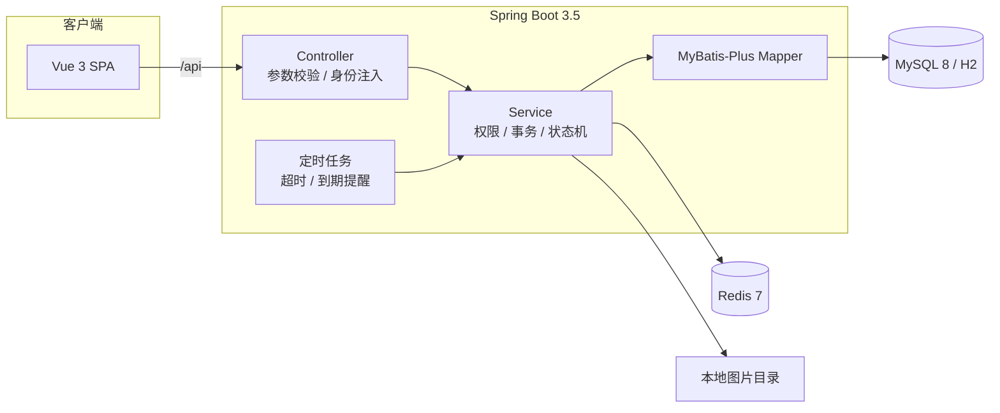

<p align="center">
  
</p>

<h1 align="center">同学借一下 · 校园物品借用平台</h1>

<p align="center">
  <strong>让校园里的闲置物品，在同学之间安全地流动起来。</strong>
</p>

<p align="center">
  
  
  
  
  
  
</p>

> 一个面向校园场景的闲置物品借还平台：发布 → 检索 → 收藏 → 预约 → 审核 → 交付 → 归还 → 续期/逾期 → 站内信，覆盖完整订单生命周期。
>
> 个人项目，用于学习与求职展示。后端 Spring Boot 3.5 + MyBatis-Plus + MySQL + Redis，前端 Vue 3 + Vite。

---

## 项目简介

校园里很多闲置物品（相机、球拍、帐篷、台灯）使用频率不高，但借还过程往往靠群聊和口头约定：不知道谁有、不知道什么时候有空、借出后忘记归还。**同学借一下**把这件事做成一条可追踪的订单：

- 发布者维护物品信息、图片、校区和领取位置；
- 借用人选择未来时间段提交申请，**审核通过后才占用时段**；
- 双方在订单里完成审核、领取、归还、续期、逾期和取消；
- 关键操作写入操作日志，并给对方发送站内信。

项目重点不是"把 CRUD 写完"，而是把**预约冲突、并发审核、缓存一致性、限流和权限**这些真实问题处理清楚。

## 功能

| 模块 | 已实现能力 |
| --- | --- |
| 账号 | 注册、登录、退出、当前用户；BCrypt 密码摘要；Redis 会话 |
| 物品 | 发布、编辑、上下架、关键词搜索、分类/校区筛选、分页、图片上传、收藏 |
| 预约 | 提交申请、发布者审核、借用人取消、发布者填写原因取消、提前领取 |
| 订单 | 8 种状态、8 类动作、待审核/待领取超时处理、续期申请与审批、逾期计算与催还 |
| 消息 | 站内信分页、未读数、单条已读、全部已读；订单变更与消息同事务 |
| 发现 | 校园今日热门榜、公开已预约时段、移动端布局 |
| 安全 | Bearer Token、接口限流、物品归属与订单权限校验、统一异常响应 |

## 技术栈

| 层次 | 技术 |
| --- | --- |
| 后端 | Java 17、Spring Boot 3.5.16、Spring MVC、Spring Security、MyBatis-Plus 3.5.17、Flyway |
| 数据 | MySQL 8.0+（正式配置）、H2 MySQL 兼容模式（demo）、Redis 7 |
| 前端 | Vue 3.5、Vite 7、原生 CSS、lucide-vue-next |
| 测试 | JUnit 5、MockMvc、Mockito、H2、embedded Redis |
| 工程 | Maven、npm、Docker Compose（Redis）、Git |

## 系统架构



Redis 承担四类职责：登录会话、接口限流、物品详情缓存、今日热门榜。MySQL 保存业务事实；预约冲突、权限和交付校验始终以数据库为准，不依赖缓存。

### 数据模型

| 表 | 用途 |
| --- | --- |
| `app_user` | 账号、密码摘要、昵称、状态 |
| `category` | 物品分类 |
| `item` | 物品主体、发布者、分类、校区、上下架状态 |
| `item_image` | 物品图片地址与排序 |
| `favorite` | 用户收藏，用户 + 物品唯一 |
| `uploaded_image` | 上传文件名、上传人、实际图片类型 |
| `borrow_order` | 借用订单、起止时间、状态、超时截止时间、续期与取消原因 |
| `order_operation_log` | 状态变化、操作人/系统、备注 |
| `notification` | 站内信、关联订单、已读时间 |
| `auth_session` | 历史会话表，仅为迁移兼容保留，新版会话存 Redis |

## 技术亮点

### 1. 预约并发一致性：行锁 + `READ_COMMITTED`

同一件物品被两个借用人同时申请、发布者同时点"同意"时，只在应用层查一次冲突是不够的：数据库索引只能加速查询，不能阻止两个事务同时通过检查。

处理方式：

1. 以 `SELECT ... FOR UPDATE` 锁定物品行，所有可能影响同一物品预约的操作使用一致的加锁顺序；
2. 订单事务显式使用 `READ_COMMITTED`，避免 MySQL 默认 `REPEATABLE_READ` 下等待锁后仍用旧快照判断冲突；
3. 拿到锁后重新读取订单与有效预约，按 `[start, end)` 判断重叠：`existing.start < requested.end AND existing.end > requested.start`；
4. 状态更新使用条件更新，订单变更、操作日志和站内信在同一事务内提交或回滚。

集成测试验证了两个冲突申请同时审核时最多通过一个，以及日志写入失败时订单整体回滚。实现见 [OrderServiceImpl.java](backend/src/main/java/com/campus/share/service/impl/OrderServiceImpl.java)，完整状态图与截止时间规则见 [业务说明](backend/docs/business.md)。

### 2. 详情缓存三防：穿透、击穿、旧值回填

`GET /api/items/{id}` 使用 Cache Aside：

- **防穿透**：数据库不存在的物品写入 30 秒空值标记，避免无效 ID 反复打库；
- **防击穿**：未命中时用 Redisson 分布式锁 + 双重检查，只允许一个请求重建缓存；获取锁超时或缓存故障时快速失败，避免请求集中回源压垮 MySQL；
- **防旧值回填**：每次失效更换代次号，回填时用 Lua 比较代次，避免修改前启动的查询把旧数据重新写回；
- **事务边界**：创建、修改、上下架在数据库事务提交后失效缓存，事务回滚不影响已有缓存。

实现见 [ItemDetailCache.java](backend/src/main/java/com/campus/share/service/ItemDetailCache.java)。

### 3. 认证、会话与接口限流

- 密码只保存 BCrypt 摘要；登录成功后生成 43 位随机 Token；
- Redis 只保存 Token 的 SHA-256 摘要（键）与用户 ID/到期时间（值），默认 8 小时 TTL，退出即删除当前会话；
- 认证时仍查询用户状态，账号禁用立即生效；
- 登录、注册、预约分别按 IP/用户维度做固定窗口限流，Lua 原子执行计数与过期设置，超限返回 `429` + `Retry-After`；Redis 故障返回 `503`，不放行受限写操作。

实现见 [RateLimitInterceptor.java](backend/src/main/java/com/campus/share/config/RateLimitInterceptor.java) 与 [RedisSessionStore.java](backend/src/main/java/com/campus/share/security/RedisSessionStore.java)。

### 4. 校园今日热门榜

- 只统计成功读取物品详情的请求，发布者查看自己的物品不计入；
- 登录用户按账号 ID 去重，匿名用户按 TCP `remoteAddr` 去重，不信任请求携带的转发头；
- 同一访客 10 分钟内重复查看同一物品只计一次；
- Redis Sorted Set 按北京时间自然日分键，Lua 原子执行去重、累加与过期设置；
- 读取时批量查询数据库，过滤下架/已删除物品并补足排名；热榜故障返回 `available=false`，前端可独立重试。

实现见 [ItemPopularityService.java](backend/src/main/java/com/campus/share/service/ItemPopularityService.java)。

## 快速开始

### 环境要求

- JDK 17 或兼容版本
- Maven 3.6.3+
- Node.js 20.19+ 或 22.12+
- Redis 7（必需）
- MySQL 8.0+（使用 `mysql` 配置时需要；`demo` 使用 H2，不需要 MySQL）
- Docker Desktop（可选，用于启动 Redis）

### 1. 启动 Redis

```powershell
docker compose -f compose.redis.yml up -d
docker compose -f compose.redis.yml exec redis redis-cli ping
```

返回 `PONG` 即可。也可以直接使用本机 `127.0.0.1:6379` 的 Redis。端口和密码可通过 `REDIS_HOST`、`REDIS_PORT`、`REDIS_PASSWORD` 等环境变量调整。

### 2. 启动后端（demo，H2 内存库）

```powershell
cd backend
mvn spring-boot:run "-Dspring-boot.run.profiles=demo"
```

健康检查：<http://127.0.0.1:8080/api/health>，`data.status` 应为 `UP`。

`demo` 配置使用 H2 内存数据库，启动时由 Flyway 自动建表，**重启后账号和业务数据都会清空**；不创建默认账号，请先注册。

### 3. 启动前端

另开一个终端：

```powershell
cd frontend
npm install
npm run dev
```

打开终端输出的地址（默认 <http://127.0.0.1:5173>）。Vite 会把 `/api` 代理到 `http://127.0.0.1:8080`；后端端口不同可设置 `API_TARGET`。

### 4. 切换 MySQL（数据持久化）

先创建数据库：

```sql
CREATE DATABASE campus_share CHARACTER SET utf8mb4 COLLATE utf8mb4_0900_ai_ci;
```

设置环境变量后启动：

```powershell
$env:DB_USERNAME = '你的数据库账号'
$env:DB_PASSWORD = '你的数据库密码'
# 非默认地址时才需要：
# $env:DB_URL = 'jdbc:mysql://127.0.0.1:3306/campus_share?useUnicode=true&characterEncoding=UTF-8&connectionTimeZone=UTC'

cd backend
mvn spring-boot:run "-Dspring-boot.run.profiles=mysql"
```

Flyway 会自动执行 `db/migration` 下的 V1–V3 迁移。不要修改已经执行过的迁移，后续结构变更请新增 V4 及之后的文件。

### 5. 构建与测试

```powershell
cd backend
mvn test
mvn package

cd ../frontend
npm run build
```

## 接口示例

所有响应统一为：

```json
{ "code": "OK", "message": "操作成功", "data": {} }
```

失败时返回对应 HTTP 状态码与业务码，`data` 为 `null`。受保护接口需要请求头：

```http
Authorization: Bearer <accessToken>
```

| 模块 | 代表接口 |
| --- | --- |
| 认证 | `POST /api/auth/register`、`POST /api/auth/login`、`GET /api/auth/me`、`POST /api/auth/logout` |
| 物品 | `GET /api/items`、`GET /api/items/{id}`、`POST /api/items`、`PUT /api/items/{id}`、`PATCH /api/items/{id}/status` |
| 图片 | `POST /api/media`、`GET /api/media/{name}` |
| 收藏 | `GET /api/favorites`、`PUT /api/favorites/{itemId}`、`DELETE /api/favorites/{itemId}` |
| 预约 | `POST /api/orders`、`GET /api/orders`、`GET /api/orders/{id}`、`PATCH /api/orders/{id}/actions/{action}` |
| 续期 | `POST /api/orders/{id}/renewal`、`PATCH /api/orders/{id}/renewal/approve`、`PATCH /api/orders/{id}/renewal/reject` |
| 消息 | `GET /api/notifications`、`GET /api/notifications/unread-count`、`PATCH /api/notifications/{id}/read`、`PATCH /api/notifications/read-all` |

完整字段、参数和错误码见 [API 说明](backend/docs/api.md)。

## 项目结构

```text
campus-share/
├── backend/
│   ├── src/main/java/com/campus/share/
│   │   ├── controller/     HTTP 接口、参数校验
│   │   ├── service/        业务接口与实现（权限、事务、状态机）
│   │   ├── mapper/         MyBatis-Plus Mapper
│   │   ├── entity/ dto/ vo/
│   │   ├── security/       认证身份与会话
│   │   ├── config/         安全、Redis、限流配置
│   │   ├── common/         统一响应与异常
│   │   └── task/           定时任务
│   ├── src/main/resources/
│   │   ├── application*.yml
│   │   ├── db/migration/   Flyway V1–V3
│   │   └── mapper/         MyBatis XML
│   └── src/test/           H2 + embedded Redis 集成测试
├── frontend/
│   ├── src/                Vue 3 页面与请求封装
│   └── scripts/            Playwright 浏览器回归脚本
├── scripts/                本地启动与演示数据脚本
└── compose.redis.yml       Redis 开发环境
```

## 测试与验证

```powershell
cd backend
mvn test
```

- 测试使用独立的 H2 内存库（MySQL 兼容模式）和临时 embedded Redis，不会操作开发库或开发 Redis；
- 共 **53 个集成测试**，覆盖认证、物品权限、筛选分页、收藏隔离、图片上传、预约状态流转、并发审核冲突、相邻时段、重复操作、超时、事务回滚、缓存 TTL/失效/旧值回填、限流、消息、续期和逾期；
- 前端另有 Playwright 回归脚本，覆盖真实浏览器下的注册登录、发布修改、收藏、预约、审核、取消、消息和移动端布局。

需要说明的验证边界：

- H2 与真实 MySQL 仍有差异，真实 MySQL 的迁移与并发验证建议在自己的数据库上再跑一遍；
- 缓存故障时的策略是**快速失败、限制集中回源**，不是所有场景都回源；
- 前端浏览器脚本依赖本机 Edge/Playwright，默认在独立演示环境运行。

详细记录见 [验证记录](backend/docs/verification.md)。

## 已知边界与后续计划

当前版本是一个可运行的单体应用，适合学习和面试展示，但还不是生产级部署：

- demo 使用 H2 内存库，重启即清空；长期数据请切换 MySQL；
- 图片保存在本地 `backend/data/uploads`，容器化部署需要挂载持久化目录，生产建议换 MinIO/OSS；
- 站内信通过前端每 30 秒轮询未读数，暂未使用 WebSocket/SSE；
- 尚未提供完整的前后端 Docker Compose、CI 流水线和压测数据；
- 规划中：GitHub Actions、全量 Docker Compose、AI 借用助手（Spring AI + RAG + 工具调用）。

## 文档

- [后端说明](backend/README.md)
- [API 说明](backend/docs/api.md)
- [业务规则与状态机](backend/docs/business.md)
- [验证记录](backend/docs/verification.md)
- [前端说明](frontend/README.md)
- [IDEA 启动说明](.run/README.md)

## License

本项目使用 [MIT License](LICENSE)。

如果这个项目对你有帮助，欢迎点一个 Star ⭐。
