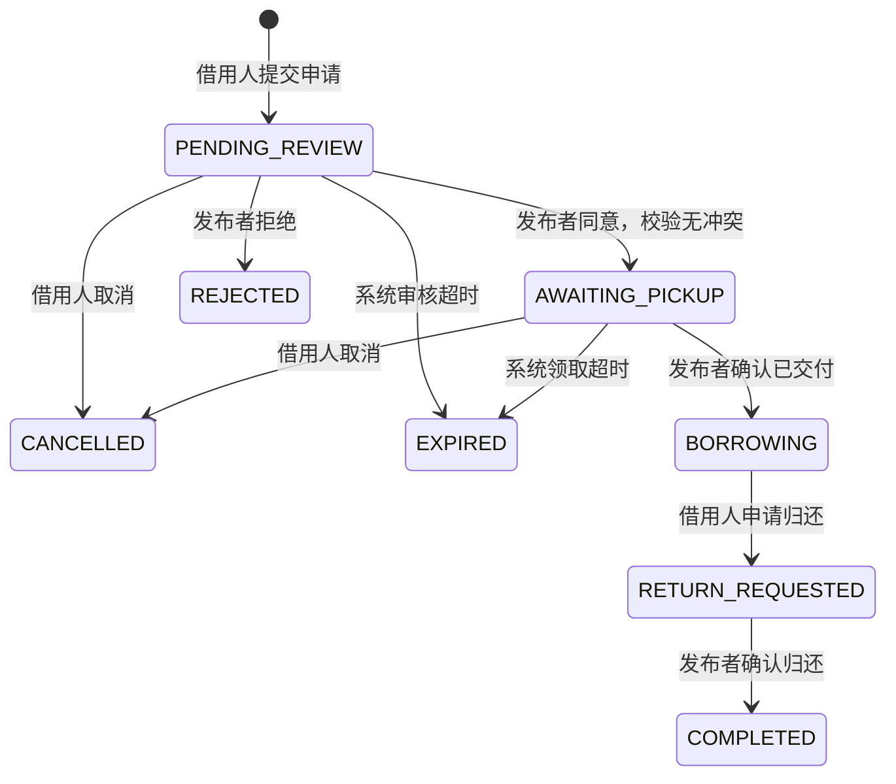

# 第一版业务约定

用户同时是发布者和借用人；一条物品记录对应一件实物。平台免费借用，不处理支付、押金或赔偿。图片属于具体物品，用户只能修改自己发布的物品。下架阻止新申请，已有订单仍需处理。

借用人选择未来的开始、结束时间，不能借自己的物品。提交申请不会占用时段；发布者同意后才占用时段。时间段为 `[start, end)`，相邻时间段可以衔接。数据库时间统一保存 UTC，前端显示时转换成用户本地时间。

## 订单状态

| 状态 | 中文 | 占用原预约时段 |
| --- | --- | --- |
| PENDING_REVIEW | 待审核 | 否 |
| AWAITING_PICKUP | 待领取 | 是 |
| BORROWING | 借用中 | 是 |
| RETURN_REQUESTED | 待确认归还 | 是 |
| COMPLETED | 已完成 | 否 |
| REJECTED | 已拒绝 | 否 |
| CANCELLED | 已取消 | 否 |
| EXPIRED | 已超时 | 否 |

待审核截止时间取“提交后 24 小时”和“预约开始时间”的较早值；待领取截止时间取“预约开始后 2 小时”和“预约结束时间”的较早值。定时任务每分钟最多处理 100 条到期记录，并写系统操作日志。借用中逾期不自动标记为已完成或已超时，应保留状态，仍可申请归还。若前一订单已超过预约结束时间仍未实际归还，下一单领取前必须检查实物是否仍被借用，不能单凭预约结束时间认定已可交付。

## 审核事务

审核通过时必须在一个事务内：锁定物品行 → 检查订单状态、物品状态与时间 → 查询有效预约冲突 → 条件更新订单 → 写操作记录。所有可能影响同一物品预约的操作采用一致的加锁顺序。

冲突条件：`existing.start_time < requested.end_time AND existing.end_time > requested.start_time`。数据库索引仅用于加速，不会自动防止重叠预约。状态更新和日志一起提交或回滚；状态条件用于抵御重复操作与定时任务竞争。订单变更事务显式采用 READ_COMMITTED 隔离级别，避免 MySQL 默认 REPEATABLE_READ 下等待物品锁后仍使用旧快照判断冲突。H2 集成测试已验证两个冲突申请同时审核最多通过一个，以及日志写入失败时状态回滚；真实 MySQL 的并发测试仍待执行。

## 表结构

| 表 | 用途 |
| --- | --- |
| app_user | 账号、密码摘要、昵称、账号状态 |
| auth_session | 访问令牌摘要、用户、到期时间 |
| category | 物品分类 |
| favorite | 当前用户收藏的物品，用户与物品组合唯一 |
| uploaded_image | 上传文件名、上传人、实际图片类型 |
| item | 发布者、分类、名称、描述、校区、领取位置、上下架状态 |
| item_image | 图片地址和排序 |
| borrow_order | 借用人、物品、起止时间、状态和超时截止时间 |
| order_operation_log | 状态变化、操作人或系统、备注、操作时间 |

物品可预约与否应结合目标时间查询订单，不在物品表维护全局“已借出”布尔字段。所有借用和发布权限以认证用户 ID 判断，不使用昵称判断归属。
