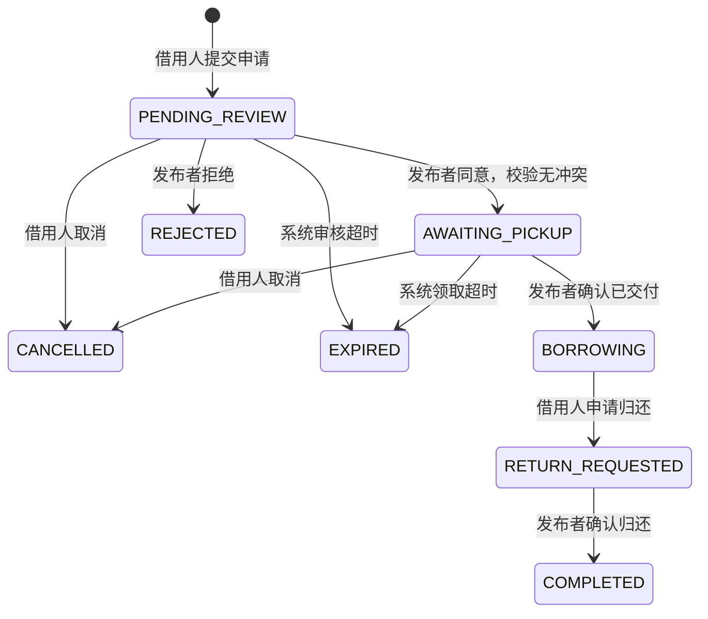

# 第一版业务约定

用户同时是发布者和借用人；一条物品记录对应一件实物。平台免费借用，不处理支付、押金或赔偿。图片属于具体物品，用户只能修改自己发布的物品。下架阻止新申请，已有订单仍需处理。

借用人选择未来的开始、结束时间，不能借自己的物品。提交申请不会占用时段；发布者同意后才占用时段。时间段为 `[start, end)`，相邻时间段可以衔接。数据库时间统一保存 UTC，前端显示时转换成用户本地时间。

## 订单状态

| 状态 | 中文 | 占用原预约时段 |
| --- | --- | --- |
| PENDING_REVIEW | 待审核 | 否 |
| AWAITING_PICKUP | 待领取 | 是 |
| BORROWING | 借用中 | 是 |
| RETURN_REQUESTED | 待确认归还 | 是 |
| COMPLETED | 已完成 | 否 |
| REJECTED | 已拒绝 | 否 |
| CANCELLED | 已取消 | 否 |
| EXPIRED | 已超时 | 否 |

待审核截止时间取“提交后 24 小时”和“预约开始时间”的较早值；待领取截止时间取“预约开始后 2 小时”和“预约结束时间”的较早值。定时任务每分钟最多处理 100 条到期记录，并写系统操作日志。借用中逾期不自动标记为已完成或已超时，应保留状态，仍可申请归还。若前一订单已超过预约结束时间仍未实际归还，下一单领取前必须检查实物是否仍被借用，不能单凭预约结束时间认定已可交付。

## 审核事务

审核通过时必须在一个事务内：锁定物品行 → 检查订单状态、物品状态与时间 → 查询有效预约冲突 → 条件更新订单 → 写操作记录。所有可能影响同一物品预约的操作采用一致的加锁顺序。

冲突条件：`existing.start_time < requested.end_time AND existing.end_time > requested.start_time`。数据库索引仅用于加速，不会自动防止重叠预约。状态更新和日志一起提交或回滚；状态条件用于抵御重复操作与定时任务竞争。订单变更事务显式采用 READ_COMMITTED 隔离级别，避免 MySQL 默认 REPEATABLE_READ 下等待物品锁后仍使用旧快照判断冲突。H2 集成测试已验证两个冲突申请同时审核最多通过一个，以及日志写入失败时状态回滚；真实 MySQL 的并发测试仍待执行。

## 表结构

| 表 | 用途 |
| --- | --- |
| app_user | 账号、密码摘要、昵称、账号状态 |
| auth_session | 历史会话表，保留迁移兼容，新版不再读写；会话存 Redis |
| category | 物品分类 |
| favorite | 当前用户收藏的物品，用户与物品组合唯一 |
| uploaded_image | 上传文件名、上传人、实际图片类型 |
| item | 发布者、分类、名称、描述、校区、领取位置、上下架状态 |
| item_image | 图片地址和排序 |
| borrow_order | 借用人、物品、起止时间、状态和超时截止时间 |
| order_operation_log | 状态变化、操作人或系统、备注、操作时间 |

物品可预约与否应结合目标时间查询订单，不在物品表维护全局“已借出”布尔字段。所有借用和发布权限以认证用户 ID 判断，不使用昵称判断归属。

审核通过、订单为待领取时，发布者可在预约开始前当面交付并确认领取，订单立即进入借用中；预约起止时间保持不变，另记录实际领取时间 picked_up_at。领取仍受原领取截止时间限制，同一物品有借用中或待确认归还的订单时，不能再次交付。提前领取必须检查 `[当前时间, 预约结束时间)` 与其他有效预约是否冲突。领取后提交申请、审核和公开时段均按实际领取时间计算占用，防止预约开始前的时间被重复分配。

## 续期

仅借用人能为未到期的 BORROWING 订单申请续期，新结束时间必须晚于原结束时间。每单同时只能存在一个待审核申请；同一申请重复提交不重复写日志或消息。续期待审核不占用额外时段，也不改变原归还时间。

发布者同意时锁定物品行，重新检查原订单尚未到期、仍在借用中且延长时段无有效预约冲突，再更新结束时间。拒绝保留原归还时间，借用人可重新申请。申请归还或到期后，未处理的续期失效。续期与新预约审核使用同一物品锁，保证并发下不会同时占用冲突时段。每轮续期有独立序号，消息不会因再次申请而被错误去重。

## 逾期与催还

BORROWING / RETURN_REQUESTED 且 `end_time <= 当前时间` 即为逾期。接口实时返回 overdue、overdueMinutes，不依赖定时任务修改状态；不足一分钟显示一分钟。逾期不自动完成，不释放实物，仍允许申请归还和确认归还。

存在逾期未完成归还的订单时，限制该借用人提交新预约、通过新预约审核和领取其他订单；发布者确认归还后自动解除。发布者可对逾期订单催还，同一订单按北京时间每天最多生成一条人工催还消息。

## 站内消息

预约申请通知发布者，审核、领取、归还完成通知借用人，取消和归还申请通知对方，续期申请与审核结果通知相应用户。每分钟任务为24小时内到期的已领取订单生成到期提醒，逾期后通知双方；按订单、事件、接收人和对应归还时间去重，续期后的新归还时间可重新提醒。

订单变更、操作日志和相关消息处于同一数据库事务，任一写入失败全部回滚。定时处理将超时和提醒候选合并，统一按物品 ID 加锁，批量最多读取100条超时候选和100条提醒候选。消息仅接收人可查询和标记已读，支持分页、未读数与全部已读；关联订单仅双方可查看。前端每30秒更新未读数，列表和订单提供手动刷新。

## 发布者取消

发布者可在 PENDING_REVIEW / AWAITING_PICKUP 阶段取消，必须填写不超过500字的非空原因。原因保存在订单中并通知借用人；取消后释放预约时段。已领取订单禁止直接取消，继续走归还流程。已取消订单重复操作不会重复写日志或发送消息。

以上功能由 V3 迁移增加 notification 表和订单扩展字段，保留已有订单数据；历史已领取订单的实际领取时间为空时，以原预约开始时间作为占用起点。

## 物品详情缓存

GET 物品详情采用 Redis Cache Aside：命中直接返回公开物品信息，未命中从数据库读取并缓存，默认有效期2分钟；不存在的物品不写缓存。事务中的详情查询绕过共享缓存，创建、修改和上下架在数据库事务成功提交后失效，事务回滚不影响原缓存。读缓存时获取随机代次标识，回填时通过 Lua 比较代次；修改后更换代次并删除详情，防止较早开始的查询将旧值重新回填。

Redis 故障或缓存内容损坏时回源数据库，不让缓存失败阻断物品写入；该实例暂时绕过缓存直到旧缓存有效期结束。损坏数据会被清除。缓存是最终一致的性能优化，Redis 故障期间跨实例失效不保证即时同步，以有效期兜底。列表、排行榜信息、预约冲突、物品归属和交付校验继续使用数据库，不依据缓存中的上下架或占用信息执行业务。带令牌请求仍需要 Redis 会话认证，认证故障的503规则不变。

## 校园今日热门

首页展示按浏览热度降序排列的当天上架物品。只统计成功读取物品详情的请求；发布、修改、收藏、普通列表与查询排行榜本身不计数。已登录发布者查看自己物品不计入，下架物品不计入。

登录用户按账号 ID 去重，同账号多个令牌共用计数；匿名用户按 TCP remoteAddr 去重，不信任请求携带的转发头。身份先做 SHA-256 后存入 Redis，不存原始 IP。同一访客在10分钟内重复查看同一物品只计一次，超过窗口可再次计入。共享网络下匿名访客可能共用计数额度；该热度表示去重后的浏览次数，并非精确的独立访客数。

Sorted Set 按北京时间自然日分键；每天零点切换新榜，旧榜从最后一次计数起保留48小时。Lua 将访客去重、热度增加、设置有效期一起执行，避免并发重复计数与无期限键。排行榜读取时批量查询当前数据库信息，过滤下架或已不存在的物品，并继续读取后续排名补足数量；相同热度按 Redis 成员顺序排列。下架不清除当天历史浏览量，重新上架后可恢复当天排名。

热度记录失败不影响详情返回；排行榜不可用时返回 available=false 和空列表，前端显示重试入口，不伪造排名。可通过 app.items.cache-ttl 和 app.items.popularity-window 调整缓存有效期和热度去重窗口。这两项功能不新增数据库表或迁移。
